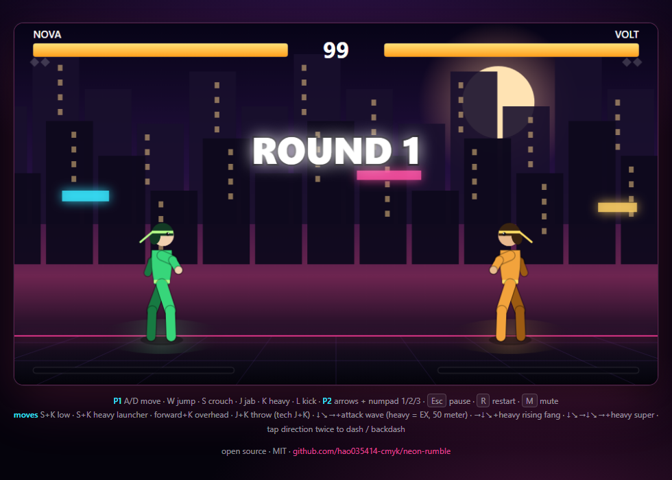

# NEON RUMBLE

A dependency-free 2D fighting game that runs in the browser. Six fighters, one ranged tool each, five stages, and a fully synthesized soundtrack — no engine, no build step, no image or audio assets.

Play: https://hao035414-cmyk.github.io/neon-rumble/

## Features

- **Six fighters with different kits** — KAI (balanced), RIN (rushdown), VOLT (grappler), NOVA (archer), SABER (combo), ECHO (setplay). Everyone shares the same normals; each fighter owns a U ranged tool, an S special and a super.
- **U ranged system** — low damage, easy to dodge, one projectile per player, usable in the air once per jump. Cancel a normal into U to keep the pressure going.
- **Real fighting-game logic** — frame data, blockstun, hitstun decay, pushback scaling, juggles, throws with tech, invincible reversals, projectiles that clash.
- **Character and stage select** — 30 second pick, random slots, mirror matches with alternate palettes, CPU difficulty, loser picks the stage in 2P.
- **Five stages, five BGM tracks** — neon city, desert dusk, snow peak, grassland, rainy night. All music is synthesized with WebAudio at runtime; no audio files are shipped.
- **Zero dependencies** — plain ES modules + Canvas 2D. The simulation is DOM-free and tested under Node.

## Play

Open the live build, or serve the folder locally:

    python -m http.server 8080
    # http://localhost:8080

Title: Enter for 1P vs CPU, 2 for local 2P. Then pick a fighter (A/D + J) and a stage (J).

### Controls

| Action | Player 1 | Player 2 |
| --- | --- | --- |
| Move / jump / crouch | A D / W / S | arrows / up / down |
| Jab / heavy / kick | J / K / L | numpad 1 / 2 / 3 |
| Ranged (U) | U | numpad 4 |
| Special (S) | motion + attack | mirrored motion + attack |
| Super (100 meter) | double motion + heavy | mirrored |
| Throw / tech | J + K | 1 + 2 |
| Low / launcher | S + L / S + K | down + 3 / down + 2 |
| Overhead | forward + L | forward + 3 |
| Dash / backdash | tap direction twice | tap direction twice |

Esc pause, R restart, C back to select, Q title, M mute.

### Stages and music

| Stage | BGM |
| --- | --- |
| NEON CITY / 霓虹街道 | synthwave, 124 BPM, A minor |
| DESERT DUSK / 荒漠落日 | 96 BPM, phrygian colour, dry drums |
| SNOW PEAK / 雪山之巅 | 72 BPM, sparse bells, no drums |
| GRASSLAND WIND / 草原长风 | 104 BPM, pentatonic, bright plucks |
| RAINY NIGHT / 雨夜街头 | 84 BPM, lo-fi, soft percussion |

## How it is built

| File | Responsibility |
| --- | --- |
| src/config.js | Frame data, characters, projectiles, input maps |
| src/characters.js | Per-character U / S / super mapping and stats |
| src/fighter.js | Per-fighter state machine, movement, boxes |
| src/engine.js | Hit resolution, projectiles, rounds, camera |
| src/ai.js | Reaction-delayed CPU with per-kit behaviour |
| src/select.js | Character/stage state machine (DOM-free) |
| src/render.js | Stages, fighters, effects, HUD |
| src/render-select.js | Select, stage and VS screens |
| src/audio.js | Procedural BGM engine |
| src/audio-tracks.js | Five stage tracks + menu track |
| src/stages.js | Stage palettes and music mapping |
| src/main.js | Loop, screens, pause, audio |

    npm test                     # simulation + audio + select + stage tests
    node tools/matchups.mjs 60   # 6x5 AI matchup matrix
    node tools/balance.mjs 300   # difficulty ladder
    node tools/perf.mjs          # simulation cost

## Roadmap

- [x] Six fighters with unique kits
- [x] Character and stage select
- [x] Five stages with per-stage BGM
- [ ] Per-match BGM variations
- [ ] Training mode with hitbox display
- [ ] Gamepad support
- [ ] Replay recording

## License

MIT — see LICENSE.
