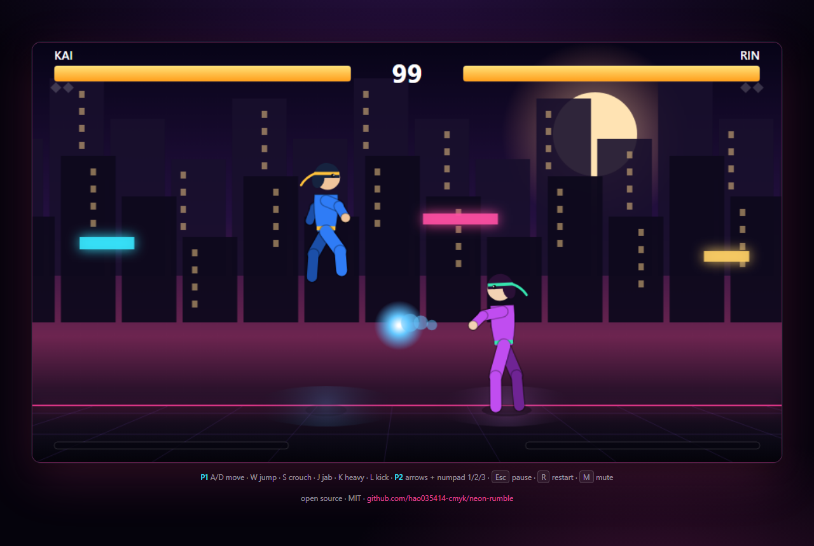

# NEON RUMBLE

**A dependency-free 2D fighting game that runs in the browser.** Jab, kick, anti-air, block low, and land a super in a neon city — no engine, no build step, no image assets.

[**▶ Play it**](https://hao035414-cmyk.github.io/neon-rumble/) · [Report a bug](https://github.com/hao035414-cmyk/neon-rumble/issues)

[](https://github.com/hao035414-cmyk/neon-rumble/actions/workflows/test.yml)



## Features

- **Classic 1v1 fighting rules** — best of 3 rounds, 99-second timer, KO and time-over.
- **Six normals** — jab, heavy, kick, crouching low, jump-in, plus a projectile special and a 100-meter super.
- **Real fighting-game logic** — startup/active/recovery frames, hitstun, blockstun, knockdowns, invulnerable wake-up, pushback, combo scaling.
- **Correct blocking rules** — lows must be crouch-blocked, jump-ins are overheads, projectiles chip.
- **Motion inputs** — quarter-circle forward for the special, double quarter-circle for the super.
- **A readable CPU** — approaches, pokes, anti-airs, blocks and throws fireballs.
- **Local 2P** on one keyboard.
- **Zero dependencies** — plain ES modules + Canvas 2D. The simulation is DOM-free and unit-tested under Node.

## Play

### In the browser

Open the [live build](https://hao035414-cmyk.github.io/neon-rumble/), or serve the folder locally:

```bash
python -m http.server 8080
# http://localhost:8080
```

Any static file server works; there is nothing to install or compile.

### Controls

| Action | Player 1 | Player 2 |
| --- | --- | --- |
| Move | `A` / `D` | `←` / `→` |
| Jump | `W` | `↑` |
| Crouch | `S` | `↓` |
| Jab (light) | `J` | `1` (numpad) |
| Heavy | `K` | `2` (numpad) |
| Kick | `L` | `3` (numpad) |
| Special | `↓ ↘ →` + attack | `↓ ↙ ←` + attack |
| Super (100 meter) | `↓ ↘ → ↓ ↘ →` + heavy | `↓ ↙ ← ↓ ↙ ←` + heavy |

`Esc` pause · `R` restart · `M` mute.

### Rules

- First to **2 rounds** wins. A round ends on KO or when the 99-second timer expires (higher health wins).
- **Specials** are free; the **super** costs a full meter. Meter builds on hits, blocks and taking damage.
- **Lows** (`S` + kick) must be crouch-blocked; **jump attacks** are overheads and must be stand-blocked.
- Combos scale: every extra hit deals a little less damage.
- Knockdowns give a short invulnerable wake-up, so you cannot be looped forever.

## How it is built

| File | Responsibility |
| --- | --- |
| `src/config.js` | Frame data, characters, input maps |
| `src/fighter.js` | Per-fighter state machine, movement, boxes |
| `src/engine.js` | Hit resolution, projectiles, rounds, camera |
| `src/ai.js` | CPU opponent |
| `src/render.js` | Stage, procedural fighters, effects, HUD |
| `src/input.js` | Keyboard and motion recognition |
| `src/main.js` | Loop, title screen, pause, audio |

The simulation (`fighter.js` + `engine.js` + `ai.js`) never touches the DOM, which is why it can be tested headlessly:

```bash
npm test
```

The test suite runs a full CPU-vs-CPU match, then checks strikes, blocking, projectiles, supers, KO flow and round resets.

## Roadmap

- [ ] More characters and stages
- [ ] Throw / tech system
- [ ] Training mode with hitbox display
- [ ] Gamepad support
- [ ] Replay recording

## License

MIT — see [LICENSE](LICENSE).

This is an original fan-made project. It is not affiliated with, endorsed by, or containing assets from SNK, Capcom, or any commercial fighting game.

---

<details>
<summary>中文说明</summary>

**NEON RUMBLE 是一个零依赖的浏览器 2D 格斗游戏。**

- 三局两胜、99 秒读秒、KO 与时间到判定
- 轻拳 / 重拳 / 踢 / 下段 / 跳跃攻击 / 波动 / 100 气超必杀
- 起手帧、命中硬直、防御硬直、击倒、起身无敌、连段递减
- 下段必须蹲防，跳跃攻击是 overhead，波动有削血
- 招式指令：下前下前 + 攻击
- 单人 CPU 与本地双人

**运行**：任意静态服务器即可，或直接打开线上版。

**测试**：`npm test` 在 Node 下跑完整对局与战斗规则断言。

</details>
